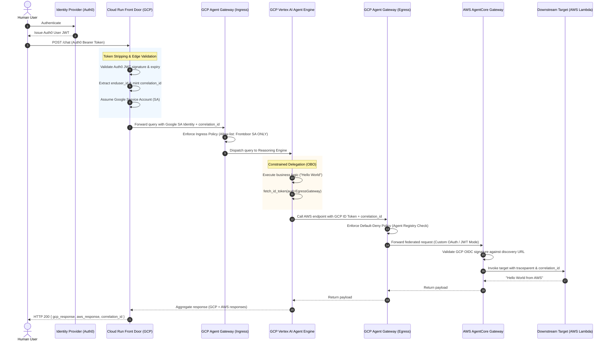

# Cross-Cloud AI Agent Identity & Constrained Delegation (OBO)

[](#security-invariants)
[-brightgreen.svg)](#architecture--token-exchange-flow)
[](#architecture--token-exchange-flow)
[](#observability--non-repudiation)

An enterprise-grade proof of concept demonstrating **cross-cloud identity federation, On-Behalf-Of (OBO) constrained delegation, and distributed audit traceability** between **Google Cloud Platform (Vertex AI Agent Engine)** and **Amazon Web Services (AWS AgentCore Gateway & Lambda)**.

---

## The Enterprise Challenge: The "Confused Deputy" in AI Agents

When deploying autonomous AI agents in multi-cloud enterprise environments, organizations face two dangerous failure modes:

1. **The Overprivileged Identity Trap:** Giving the AI agent broad administrative cloud credentials (e.g., hardcoded IAM service account keys) to access downstream databases and microservices.
2. **The Naked Token Forwarding Trap:** Passing the human user's raw session JWT (e.g., Auth0) directly into the agent runtime. If the LLM is prompt-injected, the user's primary credential can be exfiltrated.

### The Solution: Constrained On-Behalf-Of (OBO) Delegation
This architecture proves that an agent can act with **delegated authority** across cloud boundaries while ensuring:
- The human user's raw Auth0 session token **never enters the agent runtime**.
- Downstream AWS services receive short-lived, verifiable claims without sharing long-lived cross-cloud keys.
- Every downstream action is forensically auditable back to the initiating human user via cross-cloud trace correlation.

---

## Architecture & Token Exchange Flow



---

## Four Core Security Invariants

| # | Invariant | Threat Mitigated | Technical Enforcement |
|---|---|---|---|
| **1** | **No Raw User Credential in Agent Runtime** | Credential theft via LLM prompt injection / SSRF | Auth0 JWT is terminated and stripped at Cloud Run edge. The agent runtime only ever holds a Google Service Account identity. |
| **2** | **Ingress Caller Allow-Listing** | Direct unauthorized invocation of Vertex Agent | GCP Agent Gateway ingress mode enforces that only the Cloud Run Frontdoor SA can invoke `:query`. Direct calls are rejected with HTTP 403. |
| **3** | **Default-Deny Egress Boundary** | Agent exfiltration or rogue tool invocation | GCP Agent Gateway egress mode denies all outbound connections unless the destination AWS endpoint is pre-registered in the enterprise Agent Registry. |
| **4** | **Cross-Cloud Non-Repudiation** | Unattributable actions in financial/core systems | `correlation_id` and `enduser_id` are propagated alongside credentials, enabling a join between **GCP Cloud Trace / Logging** and **AWS CloudWatch / AgentCore Observability**. |

---

## Repository Structure

```
.
├── README.md                   # This showcase documentation
└── poc/
    ├── .env.example            # Environment blueprint for GCP & AWS
    ├── README.md               # Quickstart deployment instructions
    ├── frontdoor/              # Cloud Run service: Auth0 validation & token stripping
    │   ├── Dockerfile
    │   ├── main.py
    │   └── requirements.txt
    ├── agent/                  # Vertex AI Agent Engine reasoning engine
    │   ├── agent.py            # LangChain/ADK agent querying AWS
    │   ├── deploy.py           # Vertex AI deployment script
    │   └── requirements.txt
    ├── aws/                    # AWS destination infrastructure
    │   ├── lambda/handler.py   # Dummy target Lambda handler
    │   └── gateway/            # AgentCore Gateway provisioning script
    ├── scripts/
    │   ├── get_auth0_token.sh  # Auth0 password-grant helper (POC only)
    │   └── e2e_test.sh         # E2E test: happy path + 3 negative security checks
    └── docs/
        ├── adr-cross-cloud-agent-identity.md  # Architectural Decision Record (ADR)
        ├── build-spec.md                      # Detailed technical specification
        └── poc-plan.md                        # Step-by-step verification plan
```

---

## Verification & Automated Security Tests

The test suite in [`poc/scripts/e2e_test.sh`](file:///home/antigravity/cross-cloud-agent-identity/poc/scripts/e2e_test.sh) executes both happy-path end-to-end verification and three targeted negative security test cases:

```bash
# Sourcing environment configuration
set -a; source poc/.env; set +a

# Execute test suite
./poc/scripts/e2e_test.sh
```

### Negative Security Test Matrix

```
Test Scenario                               Expected Result     Status
──────────────────────────────────────────────────────────────────────────
Happy Path: End-to-end cross-cloud call     HTTP 200 OK         [PASS]
Negative A: Tampered / Expired Auth0 JWT    HTTP 401 Unauth     [PASS]
Negative B: Direct Agent Call (Bypass SA)   HTTP 403 Forbidden  [PASS]
Negative C: Unregistered Egress Destination HTTP 403 Forbidden  [MANUAL VERIFY]
```

1. **Negative Case A (Tampered JWT):** Front door immediately rejects invalid, expired, or modified Auth0 tokens before any processing reaches the agent runtime.
2. **Negative Case B (Ingress Gateway Denial):** Bypassing the front door and invoking the Vertex AI Agent Engine directly from an unauthorized identity is blocked by Agent Gateway Ingress.
3. **Negative Case C (Egress Gateway Denial):** Repointing the agent's target URL to an arbitrary destination outside the Agent Registry triggers an egress block.

---

## Observability & Non-Repudiation

When a request executes across clouds, the shared `correlation_id` allows forensic log joining across both providers:

- **Google Cloud Trace & Logging:**
  ```bash
  gcloud logging read 'jsonPayload.correlation_id="<CORRELATION_ID>"' --project=$GCP_PROJECT_ID
  ```
- **AWS CloudWatch & AgentCore:**
  Search CloudWatch log groups for `@message like /<CORRELATION_ID>/` to locate the exact downstream Lambda execution triggered by the GCP agent.

---

## Architecture Decision Records (ADRs)

For full architectural trade-offs, trust model comparisons (IAM SigV4 vs. OAuth Bearer vs. mTLS SPIFFE), and design considerations, refer to:
- [ADR: Cross-Cloud Agent Identity, Trust, and Traceability](file:///home/antigravity/cross-cloud-agent-identity/poc/docs/adr-cross-cloud-agent-identity.md)
- [Build Specification & Target State](file:///home/antigravity/cross-cloud-agent-identity/poc/docs/build-spec.md)
