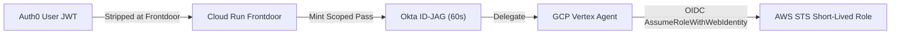

# `cross-cloud-agent-identity` Local Architecture

> **Global Ecosystem Role:** Powers **Lab 2 (`AI Agent ERP Overlay` — Delegated Identity)** on [`0trust.dev`](https://github.com/c2pig/0trust.dev/blob/main/docs/ECOSYSTEM_MAP.md).

- **Global Architecture**: [`0trust.dev/docs/labs/agentic-transaction.md`](https://github.com/c2pig/0trust.dev/blob/main/docs/labs/agentic-transaction.md)
