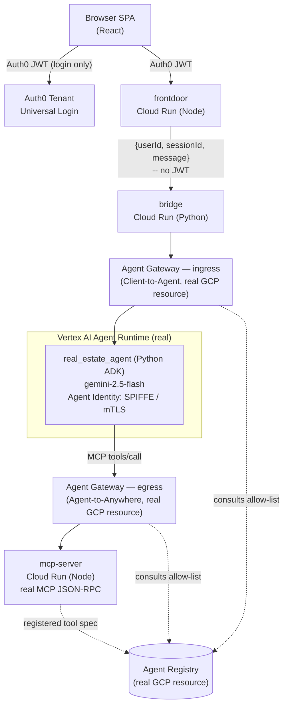
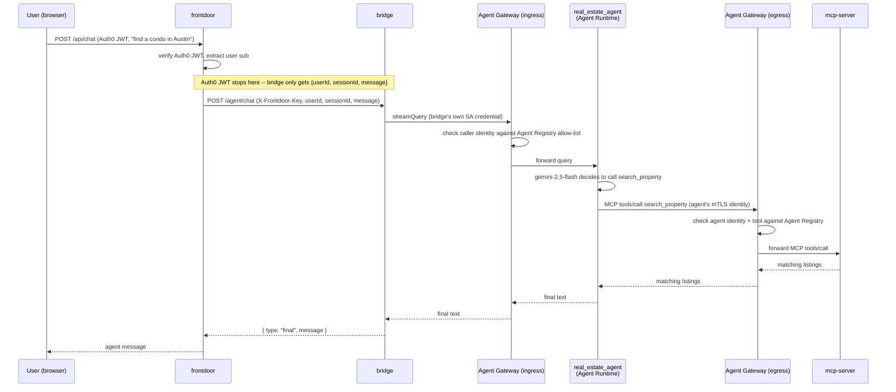
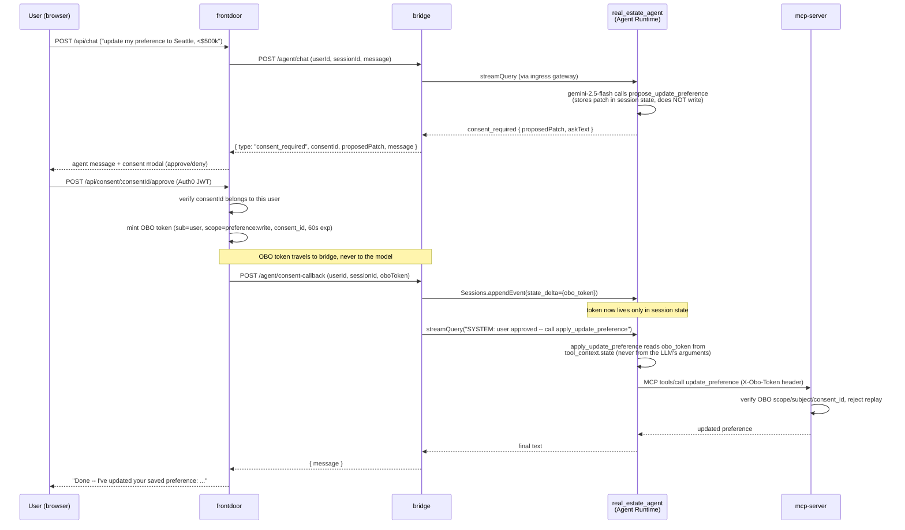
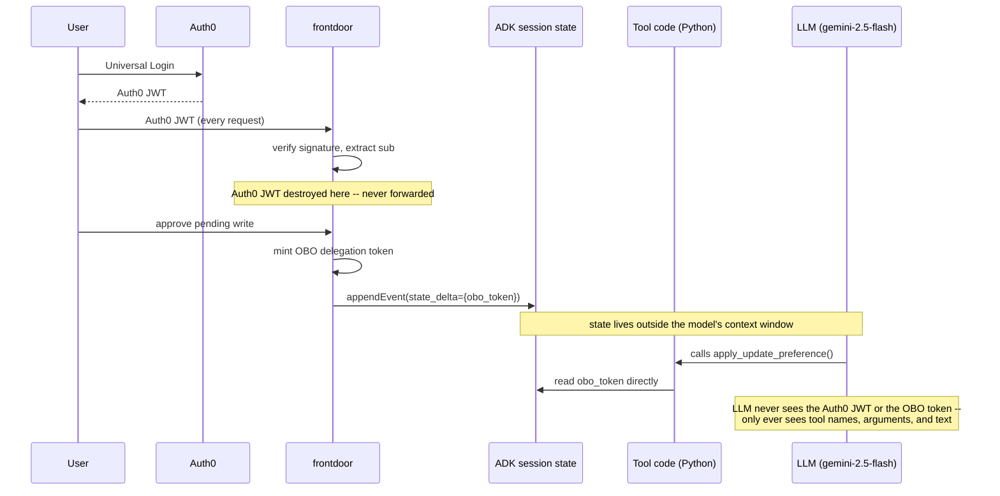

# Architecture

As of the `fresh-eyes-501103` deployment, this POC runs on the **real**
Gemini Enterprise Agent Platform primitives (not simulations of them): a
real Vertex AI Agent Runtime deployment, real Agent Gateway in both
ingress and egress modes, a real Agent Registry, real Agent Identity
(SPIFFE/mTLS), and a real MCP (Model Context Protocol) server. See
`docs/deployment.md` for the live resource names and `docs/gcp-mapping.md`
for what's still simplified.

## Components

| Component | Role | Platform primitive |
|---|---|---|
| `packages/frontend` | React SPA: registration, login, chat window, consent modal | — |
| `packages/frontdoor` | Validates the user's Auth0 JWT, brokers consent, mints OBO delegation tokens. The Auth0 JWT is never forwarded past this point. | Cloud Run (stands in for Workforce Identity Federation) |
| `packages/agent-runtime` (`real_estate_agent`) | Python ADK agent: `search_property` / `get_preference` (read, no consent) and `propose_update_preference` / `apply_update_preference` (write, gated on consent) | **Vertex AI Agent Runtime** — real managed compute, real Agent Identity |
| `packages/agent-runtime/bridge.py` | Thin Python service frontdoor calls to reach the real Agent Runtime (session create/query/state-append) — Node has no mature client library for this yet | Cloud Run; itself just another authorized caller of Agent Runtime |
| `packages/mcp-server` | Real MCP JSON-RPC server exposing the three tools; verifies the OBO delegation token on writes (the one check Agent Gateway doesn't model) | Cloud Run, registered in **Agent Registry** |
| Agent Gateway — ingress | Controls which callers (the bridge) may reach the agent at all | **real GCP resource**, `governedAccessPath: CLIENT_TO_AGENT` |
| Agent Gateway — egress | Controls which destinations the agent may call; default-deny unless registered | **real GCP resource**, `governedAccessPath: AGENT_TO_ANYWHERE` |
| Agent Registry | Central allow-list both gateways consult — agents auto-register on deploy, `mcp-server` is registered manually with its tool spec | **real GCP resource** |

No real database is used anywhere — `mcp-server` keeps properties and
preferences in memory (see `packages/mcp-server/src/data.js`).

## System diagram

## Identity model

Three distinct identities are in play, and the POC is built specifically to
keep them from ever collapsing into one:

1. **User identity** — the Auth0-authenticated end user (`sub` claim). Source
   of trust for "who is asking." The Auth0 JWT lives only between the
   browser and `frontdoor`; nothing downstream of `frontdoor` — not the
   bridge, not the agent, and never the LLM — ever sees it.
2. **Agent identity** — a real, platform-provisioned SPIFFE identity
   (`principal://.../reasoningEngines/{id}`), automatically assigned to
   `real_estate_agent` when it deployed to Agent Runtime with
   `identity_type=AGENT_IDENTITY`. Secured by auto-rotated mTLS — no shared
   secret exists anywhere for this. This is what lets `search_property` and
   `get_preference` (read-only, no user-specific side effects) happen
   without bothering the user for consent every time the agent wants to
   look something up, and it's what Agent Gateway's egress policy actually
   authorizes against Agent Registry.
3. **On-behalf-of (OBO) identity** — a short-lived, single-use delegation
   token asserting "user X approved this specific write," minted by
   `frontdoor` only after explicit user approval. It never appears in a
   chat message or the model's context: `bridge.py` injects it directly
   into the ADK session's state via the Agent Engine Sessions API
   (`appendEvent` with a `state_delta`), and only the tool function's own
   Python code (`apply_update_preference`, not the LLM) ever reads it back
   out — the same "custom auth provider" pattern Agent Identity's docs
   describe for forwarding delegated credentials.

## Flow 1 — agent-initiated read (no consent needed)

## Flow 2 — delegated write (consent required)

If the user denies instead, `frontdoor` never mints an OBO token at all —
`bridge` sends back a canned decline and `mcp-server` is never called.

## Token lifecycle at a glance

## Local dev vs. mock mode

Everything above works with zero external credentials:

- **Auth**: without a real Auth0 tenant configured, `frontdoor` and the
  frontend fall back to an explicit `ALLOW_MOCK_AUTH` mode (a typed display
  name stands in for a real login). Wiring in a real Auth0 tenant flips this
  off automatically.
- **Planner**: without `GEMINI_API_KEY`, `agent-service` uses a small
  deterministic keyword-based planner (`mockPlanner.js`) that implements the
  exact same `planTurn()` interface as the real Gemini function-calling
  planner (`geminiClient.js`). Setting `GEMINI_API_KEY` switches it over with
  no other code changes.

This is what makes `npm run dev` + `npm run smoke-test` work immediately
after `npm install`, before you've touched Auth0 or Google Cloud at all.
