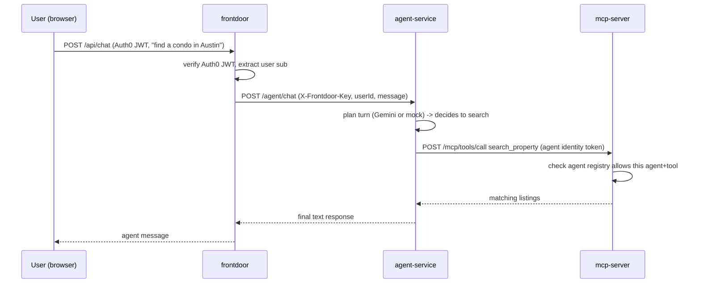
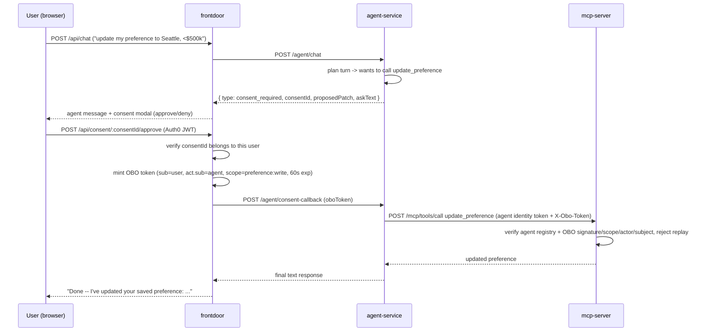

# Architecture

## Components

| Component | Role | Stands in for (real GCP) |
|---|---|---|
| `packages/frontend` | React SPA: registration, login, chat window, consent modal | A Gemini Enterprise / custom agent UI |
| `packages/frontdoor` | Validates the user's Auth0 token, brokers consent, mints OBO tokens | Workforce Identity Federation + a trust-broker/token-exchange service |
| `packages/agent-service` | Runs the agent loop (Gemini function-calling or a mock planner), owns its own agent identity | A Vertex AI Agent Engine deployment |
| `packages/mcp-server` | Mock MCP tools (`search_property`, `get_preference`, `update_preference`), enforces the agent registry + delegation checks | An MCP-fronted backend behind an Agent Gateway (egress) |

No real database is used anywhere — `mcp-server` keeps properties and
preferences in memory (see `packages/mcp-server/src/data.js`).

## Identity model

Three distinct identities are in play, and the POC is built specifically to
keep them from ever collapsing into one:

1. **User identity** — the Auth0-authenticated end user (`sub` claim). Source
   of trust for "who is asking."
2. **Agent identity** — `agent-service`'s own fixed identity
   (`agents/real-estate-agent-v1`), asserted via a signed token it mints for
   every MCP call. This is what lets `search_property` and `get_preference`
   (read-only, no user-specific side effects) happen without bothering the
   user for consent every time the agent wants to look something up.
3. **On-behalf-of (OBO) identity** — a short-lived, single-use credential
   asserting "user X delegated this specific write action to agent Y,"
   minted by `frontdoor` only after the user explicitly approves.

## Flow 1 — agent-initiated read (no consent needed)

## Flow 2 — delegated write (consent required)

If the user denies instead, `frontdoor` never mints an OBO token at all —
`agent-service` just returns a canned decline and `mcp-server` is never
called.

## Local dev vs. mock mode

Everything above works with zero external credentials:

- **Auth**: without a real Auth0 tenant configured, `frontdoor` and the
  frontend fall back to an explicit `ALLOW_MOCK_AUTH` mode (a typed display
  name stands in for a real login). Wiring in a real Auth0 tenant flips this
  off automatically.
- **Planner**: without `GEMINI_API_KEY`, `agent-service` uses a small
  deterministic keyword-based planner (`mockPlanner.js`) that implements the
  exact same `planTurn()` interface as the real Gemini function-calling
  planner (`geminiClient.js`). Setting `GEMINI_API_KEY` switches it over with
  no other code changes.

This is what makes `npm run dev` + `npm run smoke-test` work immediately
after `npm install`, before you've touched Auth0 or Google Cloud at all.
