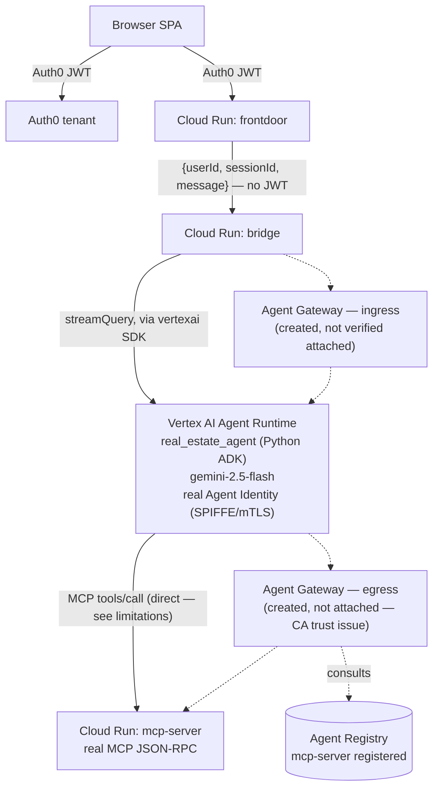

# Deployment Record — GCP Project `fresh-eyes-501103`

This document captures the architecture as actually deployed, and the
live application information for this specific instance. For the
conceptual design (identity model, consent flow, why each piece exists),
see [`architecture.md`](./architecture.md); for how each piece maps back
to real Google Gemini Agent Platform primitives, see
[`gcp-mapping.md`](./gcp-mapping.md).

This POC was upgraded from simulating the Gemini Enterprise Agent
Platform to running on its **real** primitives: a real Vertex AI Agent
Runtime deployment, a real MCP (Model Context Protocol) server, real
Agent Gateway resources, and a real Agent Registry. See "Known
limitations" below for the one piece (egress gateway enforcement) that's
created but not yet actually gating traffic.

## Live application

| | |
|---|---|
| **URL** | https://gemini-poc-frontend-3jr65s33wq-uc.a.run.app |
| **GCP project** | `fresh-eyes-501103` (`us-central1`) |
| **Auth0 tenant** | `dev-w1l51ci6zjjdb3de.us.auth0.com` |
| **Auth mode** | Real Auth0 Universal Login (`ALLOW_MOCK_AUTH=false`) |
| **Agent runtime** | Real Vertex AI Agent Runtime — `reasoningEngines/2124909025014317056`, real Gemini 2.5 Flash function-calling (no mock planner) |

## Deployed components

| Cloud Run service | URL | Service account | Ingress |
|---|---|---|---|
| `gemini-poc-frontend` | `https://gemini-poc-frontend-3jr65s33wq-uc.a.run.app` | default compute SA | `allUsers` |
| `gemini-poc-frontdoor` | `https://gemini-poc-frontdoor-67873858780.us-central1.run.app` | `gemini-poc-frontdoor@...` | `allUsers` (Auth0 JWT is the real gate) |
| `gemini-poc-agent-bridge` | `https://gemini-poc-agent-bridge-67873858780.us-central1.run.app` | `gemini-poc-agent@...` (granted `roles/aiplatform.expressUser`) | `allUsers` (app-level `X-Frontdoor-Key` check gates it) |
| `gemini-poc-mcp-server` | `https://gemini-poc-mcp-server-67873858780.us-central1.run.app` | `gemini-poc-mcp-server@...` | `allUsers` — **no agent-identity check** (removed on the assumption egress gateway would replace it; see limitations) |
| ~~`gemini-poc-agent-service`~~ | — | — | retired — replaced by the bridge + real Agent Runtime |

## GCP resources provisioned

- **APIs enabled**: Cloud Run, Artifact Registry, Secret Manager, Cloud Build, Vertex AI, Logging, Cloud Trace, Network Services, Network Security, IAP, Agent Registry, Model Armor, Cloud Resource Manager
- **Artifact Registry**: `us-central1-docker.pkg.dev/fresh-eyes-501103/gemini-agent-poc` — `frontend`, `frontdoor`, `mcp-server`, `agent-bridge` images
- **GCS bucket**: `fresh-eyes-501103-agent-engine-staging` — Agent Engine deploy artifacts (pickled agent, requirements)
- **Vertex AI Agent Runtime**: `reasoningEngines/2124909025014317056`, `identity_type=AGENT_IDENTITY` → real SPIFFE principal `agents.global.proj-67873858780.system.id.goog/resources/aiplatform/projects/67873858780/locations/us-central1/reasoningEngines/2124909025014317056`
- **Agent Gateway — ingress**: `real-estate-agent-gateway-ingress`, `governedAccessPath=CLIENT_TO_AGENT` (created, not attached to the agent)
- **Agent Gateway — egress**: `real-estate-agent-gateway-egress`, `governedAccessPath=AGENT_TO_ANYWHERE` (created, not attached — see limitations)
- **Agent Registry**: `real-estate-mcp-server` service registered with tool spec (`tool-spec` = the server's own `tools/list` response)
- **Service accounts**: `gemini-poc-frontdoor`, `gemini-poc-agent` (reused for the bridge), `gemini-poc-mcp-server`
- **IAM**: `gemini-poc-agent@...` granted `roles/aiplatform.expressUser` at project level (needed for the bridge to call `stream_query`/session APIs on the reasoning engine)
- **Secret Manager**: `gemini-poc-obo-signing-secret` (frontdoor mints, mcp-server verifies), `gemini-poc-frontdoor-to-agent-key` (frontdoor↔bridge shared secret)

## Auth0 resources provisioned

| Resource | Value |
|---|---|
| API (resource server) | `Gemini Agent POC API`, identifier `https://gemini-agent-poc/api`, RS256 |
| Application | `Gemini Agent POC` (SPA), client ID `PQR8JYTZrZJIIhi7HVdziEk4ipvTxIw1` |
| Callback / logout / origin URLs | `http://localhost:5173`, `https://gemini-poc-frontend-3jr65s33wq-uc.a.run.app` |

## What's verified working end-to-end

Tested directly against the bridge (bypassing only the browser login step,
which requires a real Universal Login redirect a curl script can't do):

1. **Agent-initiated read**: `search_property` — real Gemini 2.5 Flash decides to call the tool, calls the real MCP server over real MCP JSON-RPC, returns results.
2. **Full OBO consent flow**: `propose_update_preference` returns `consent_required` without writing anything → a real delegation token is minted → injected into the ADK session via `Sessions.appendEvent` (state_delta, never a chat message) → a follow-up turn triggers `apply_update_preference`, which reads the token from `tool_context.state` (never from an LLM-visible argument) → the real MCP write succeeds, verified by reading the preference back.

## Known limitations

- **Egress Agent Gateway is not attached.** Agent Gateway's `AGENT_TO_ANYWHERE` mode does TLS interception (re-signs outbound traffic with its own inspection CA, confirmed by the cert's own subject: `CN=Agent Gateway TLS Inspection CA`). The managed (non-BYOC) Agent Runtime deployment path we're using has no documented way to inject that CA into the container's trust store — only the BYOC (custom Dockerfile) path does. Attaching it repeatedly crashed the agent with `CERTIFICATE_VERIFY_FAILED`. **Consequence**: the agent currently calls `mcp-server` directly, and the Agent Registry entry + egress gateway enforce nothing yet.
- **`mcp-server`'s read tools (`search_property`, `get_preference`) have no caller-identity check.** This was deliberately removed when converting to real MCP protocol, on the assumption egress Agent Gateway would replace it (see `mcp-server/src/auth.js` comment). With egress not attached, that assumption doesn't hold — cheapest fix is a Cloud Run IAM invoker binding restricted to the agent's own identity, not yet applied.
- **`/healthz` is intercepted by Google's front end** on every Cloud Run service (Cloud Run/GFE reserved-path behavior) — use any other real route to check liveness.
- **Ingress Agent Gateway is created but never verified** — the bridge currently calls the deployed reasoning engine directly via the `vertexai` SDK; whether traffic would actually route through `real-estate-agent-gateway-ingress` if attached hasn't been tested.

## Next steps

1. Lock down `mcp-server` with a Cloud Run IAM invoker binding scoped to `gemini-poc-agent@...` (cheap, closes the read-tool gap).
2. If egress gateway enforcement is wanted, switch `agent-runtime` to the BYOC deployment path (custom Dockerfile, `ARG AGENT_GATEWAY_ROOT_CERTIFICATES` — Google's documented pattern) rather than retrying the managed path.
3. Verify ingress gateway attachment once egress is resolved, ideally together (both `agent_gateway_config` entries set at agent creation, not patched in after — patching an existing agent was slower and no more reliable than a fresh create in testing).
4. Clean up the deprecated `agent_engines.get_session`/`create_session` calls in `bridge.py` (SDK warns to use `agent_engines.sessions.get`/`.create` instead) — cosmetic, not urgent.
