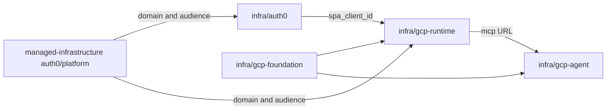

# Infrastructure as Code

Four stacks, one local state each. Nothing here redefines the Auth0 tenant. Domain, issuer, JWKS, and the default API audience are published by **managed-infrastructure** `stacks/global/auth0/platform`. Copy those outputs into the variables below. Platform state is local, so these stacks do not use `terraform_remote_state`.

```text
infra/
├── auth0/            # SPA, API, client grant
├── gcp-foundation/   # APIs, Artifact Registry, service accounts, secrets
├── gcp-runtime/      # Cloud Run: mcp-server, bridge, frontdoor, frontend
└── gcp-agent/        # staging bucket and Vertex IAM for the bridge
```



## Apply order

1. `infra/auth0` — adopt the existing SPA and API. Skip only if you already have the SPA client ID and do not want Terraform to manage Auth0 yet.
2. `infra/gcp-foundation`
3. `infra/gcp-agent` — bucket and `roles/aiplatform.expressUser`. Does not create the reasoning engine or attach gateways.
4. `infra/gcp-runtime` — two-phase, because the frontend image needs the frontdoor URL. `scripts/deploy.sh` runs this sequence and builds the images.

`scripts/deploy.sh` applies the agent stack before Cloud Run so the bridge's Vertex role exists, then sets `mcp_server_url` on that stack after the MCP service has a URL.

## Not owned here

| Object | Owner |
|---|---|
| Auth0 tenant, issuer, JWKS | managed-infrastructure `stacks/global/auth0/platform` |
| Auth0 users, Default App, ROPG spike client | Not managed |
| Reasoning engine and Agent Gateways | `packages/agent-runtime/deploy.py` and the gateway YAML files, until the Google provider has resources for them |
| Gateways attached to the engine | Left unattached. Egress attachment crashes the managed runtime. |

No secrets, `terraform.tfvars`, or state files belong in Git.
